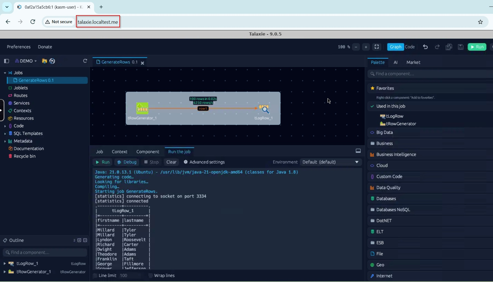
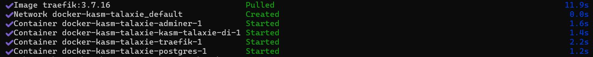
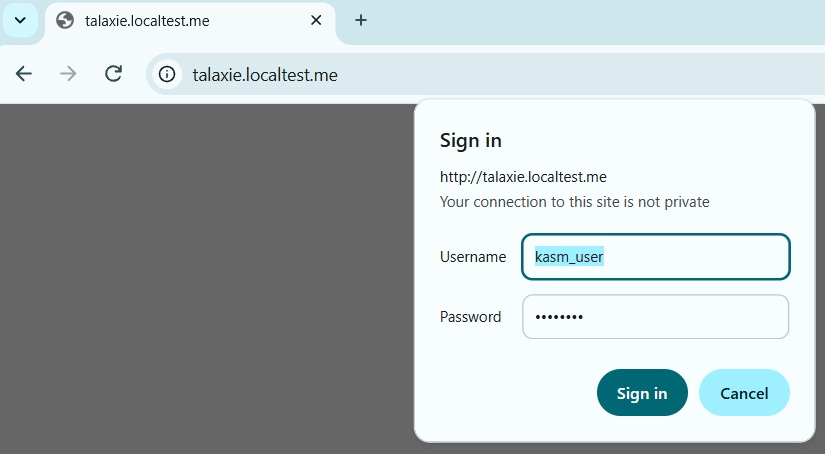
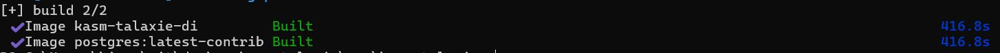

# <p align="center">KASM docker image for Talaxie open Studio (aka Talend)</p>
 
This repository aims to install **a ready to use** Talaxie (RUST Engine) using docker compose, the idea is to leverage a Linux container using KasmVNC technology streaming the application to a web browser


    
## 🧐 Features

Talaxie is installed into an ubuntu base image with all the needed stuffs to work

- Open JDK 21
- A postgres database with fake data and adminer tool (use profile -postgres)
- An automated script respawning the tool in case of restart or shutting down

About dockerfile

- As the dockerfile is generic, all Talaxie version are available (DI, ESB, BD) depend on the docker compose profile you launch
- Using [*.localtest.me](https://readme.localtest.me/) avoiding to modify your host file
- You can play with a one million lines fake customers dataset, automaticaly generated by an embeded postgres database, check for view **vw_customers**

## 🛠️ Tech Stack
- [Talaxie](https://deilink.fr)
- [Traefik](https://doc.traefik.io/traefik)
- [Postgres](https://www.postgresql.org/)

## 🧑🏻‍💻 Usage

### Getting started

Download the [docker compose file](blob:https://github.com/8d9d93b2-d792-458b-95e8-a94636916bd2) or get the full repository

```bash
$ git clone https://github.com/jsminet/docker-kasm-talaxie.git
```

#### Pulling and Starting the stack

```bash
# For data integration / ESB
$ docker compose up -d
```



####  Talaxie web access

Open your favorite web browser and navigate to **http://talaxie.localtest.me**

WARNING: some internet boxes block the redirection of **localtest.me**
domain, you can add this entry in your host file

```bash
127.0.0.1 talaxie.localtest.me
```



- User: **kasm_user**
- Password: **changeme**

### Build

This step is not mandatory as these images are hosted on my [own docker hub](https://hub.docker.com/repository/docker/jsminet/docker-kasm-talaxie/general)


#### Choose and get the needed Talaxie version

See ./app/kasm-talaxie/README.md

#### Build Talaxie and postgres images

```bash
# For data integration/ESB
$ docker compose build
```



#### Stopping and clean volumes

```bash
# For data integration/ESB
$ docker compose down -v
```


## 🛠️ Database connection

### Postgres

Open your favorite web browser and navigate to **http://adminer.localtest.me**

|Host|User|Password|Database|
|---|---|---|---|
|postgres|postgres|secret|postgres|
        
## 🍰 Contributing    
Contributions are what make the open source community such an amazing place to be learn, inspire, and create. Any contributions you make are **greatly appreciated**.

Before contributing, please read the [code of conduct](CODE_OF_CONDUCT.md) & [contributing guidelines](CONTRIBUTING.md).
            
## 🙇 Author
#### JS
- Github: [@jsminet](https://github.com/jsminet)
        
## ➤ License
Distributed under the WTFPL License. See [WTFPL LICENSE](https://en.wikipedia.org/wiki/WTFPL) for more information.