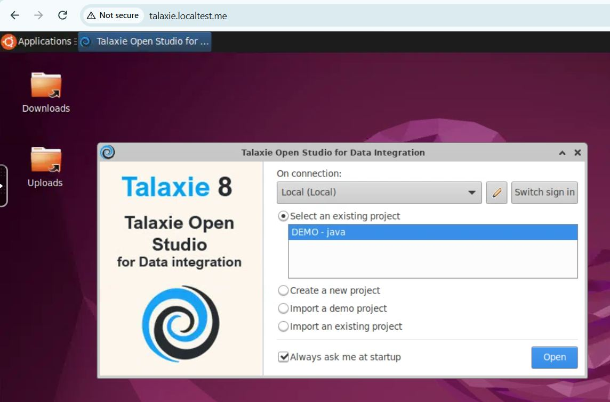
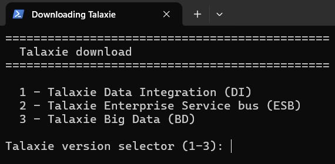
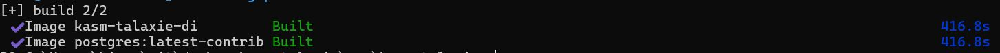
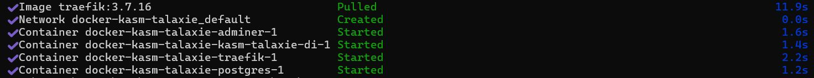

# <p align="center">KASM docker image for Talaxie open Studio (aka Talend)</p>
 
This repository aims to install **a ready to use** Talaxie (eclipse RCP client) using docker compose, the idea is to leverage a Linux container using KasmVNC technology streaming the application to a web browser


    
## 🧐 Features

Talaxie is installed into an ubuntu 22.04 LTS jammy base image with all the needed stuffs to work

- Open JDK 21
- GTK libraries + tuning for correct display rendering
- TOS_DI.ini setup for Xms and Xmx java memory setup
- A postgres database with fake data
- An automated script for auto respawn the tool in case of restart or shutting down

About dockerfile

- As the dockerfile is generic, all Talaxie version are available (DI, ESB, BD) depend on the docker compose profile you launch
- Using [*.localtest.me](https://readme.localtest.me/) avoiding to modify your host file
- You can play with a one million lines fake customers dataset, automaticaly generated by an embeded postgres database, check for view **vw_customers**

## 🛠️ Tech Stack
- [Talaxie](https://www.dataiku.com)
- [Traefik](https://doc.traefik.io/traefik)
- [Postgres](https://www.postgresql.org/)

## 🧑🏻‍💻 Usage

### Build and start

```bash
$ git clone https://github.com/jsminet/docker-kasm-talaxie.git
```

#### Choose and get the needed Talaxie version



```bash
$ ./app/kasm-talaxie/download.bat
```

#### Build Talaxie and postgres images

```bash
# For data integration
$ docker compose --profile di build
# For enterprise service bus
$ docker compose --profile esb build
# For big data
$ docker compose --profile bd build
```



#### Pulling and Starting the stack

```bash
# For data integration
$ docker compose --profile di up -d
# For enterprise service bus
$ docker compose --profile esb up -d 
# For big data
$ docker compose --profile bd up -d 
```



#### Stopping and clean volumes

```bash
# For data integration
$ docker compose --profile di down -v
# For enterprise service bus
$ docker compose --profile esb down -v
# For big data
$ docker compose --profile bd down -v
```

##  Talaxie access

Open your favorite web browser and navigate to **http://talaxie.localtest.me**

- User: **kasm_user**
- Password: **changeme**

## 🛠️ Database connection

### Postgres

Open your favorite web browser and navigate to **http://adminer.localtest.me**

|Host|User|Password|Database|
|---|---|---|---|
|postgres|postgres|secret|postgres|
        
## 🍰 Contributing    
Contributions are what make the open source community such an amazing place to be learn, inspire, and create. Any contributions you make are **greatly appreciated**.

Before contributing, please read the [code of conduct](CODE_OF_CONDUCT.md) & [contributing guidelines](CONTRIBUTING.md).
            
## 🙇 Author
#### JS
- Github: [@jsminet](https://github.com/jsminet)
        
## ➤ License
Distributed under the WTFPL License. See [WTFPL LICENSE](https://en.wikipedia.org/wiki/WTFPL) for more information.